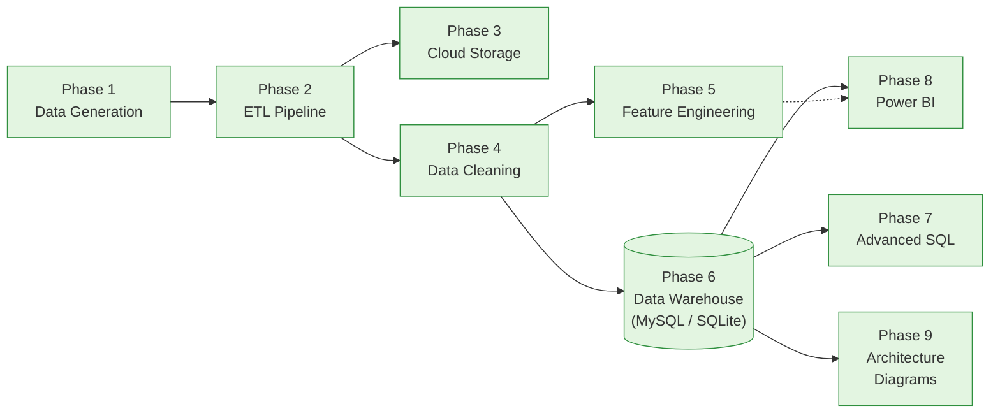

# Enterprise E-Commerce Global Supply Chain & Margin Optimization

An end-to-end data engineering and business intelligence portfolio project featuring a realistic global e-commerce dataset, a multi-source ETL pipeline, a cloud storage layer, feature-engineered metrics, a star schema warehouse (MySQL & SQLite compatible), 120+ advanced SQL analyses, and a Power BI dashboard design — answering the central business question: **why are margins shrinking, and how much of that is driven by international shipping delays and cross-border returns?**

---

## Problem Statement

A global e-commerce brand ships from 150 warehouses across 30 countries. Leadership suspects margins are shrinking, but three teams tell three different stories: supply chain blames shipping delays, finance blames discounting, and customer service blames returns. 

This project unifies orders, shipments, returns, and inventory at the order-line level into a centralized data warehouse to answer these questions with data-driven insights rather than departmental assumptions:
- **Ingest** data from transactional orders, inventory management, and shipping APIs.
- **Clean and validate** records with automated quarantine of bad rows and IQR outlier detection.
- **Engineer** critical metrics for finance (Gross/Net Margin), logistics (Shipping Delays), and customer service (Return Rates).
- **Warehouse** data into a queryable star schema optimized with foreign key indexes.
- **Analyze** patterns using window functions, CTEs, and executive dashboards.

---

## Results & KPIs

Computed across the full-scale generated dataset (500,000 orders):

| KPI | Value |
|---|---:|
| Total orders | 500,000 |
| Total revenue | $497.0M |
| Gross profit / margin | $178.0M / **35.8%** |
| Net profit / margin (after shipping, refunds, 8% assumed opex) | $115.4M / **23.2%** |
| Average order value (AOV) | $994 |
| Order return rate | 13.7% |
| Repeat purchase rate | 99.96%¹ |
| Average delivery delay | 2.39 days |
| Shipments delayed (>3 days) | 31.4% |

¹ Reflects dataset design of 500,000 orders across 50,000 customers (~10 orders/customer on average).

### Net Margin Methodology

Net margin is computed uniformly across the Python feature engineering pipeline, the SQL data warehouse, and Power BI DAX measures:

```
Product Revenue   = Order Subtotal × (1 − Order Discount %)
Gross Profit      = Product Revenue − COGS
Net Profit        = Gross Profit − Shipping Cost − Refunds − (Product Revenue × 8% assumed opex)
```

The 8% operating expense rate is configured centrally (`src/feature_engineering/config.py: ASSUMED_OPEX_RATE`) to model warehousing, payment processing, and general administrative overhead.

---

## Architecture



Detailed architecture diagrams are available in `architecture/`:

| Diagram | Description |
|---|---|
| [ETL Flow](architecture/etl_flow.png) | 3-source pipeline: extract (incremental, retry-wrapped) → validate → quarantine/transform → load → watermark state |
| [Cloud Architecture](architecture/cloud_architecture.png) | Unified storage interface with support for GCS, S3, and local dry-run modes |
| [Warehouse Star Schema](architecture/warehouse_star_schema.png) | Entity-relationship diagram: 5 dimension tables + 3 fact tables with full referential integrity |
| [Dashboard Flow](architecture/dashboard_flow.png) | Data model, DAX calculation logic, and page layout for executive reporting |
| [Git Workflow](architecture/git_workflow.png) | Structured branching and release-tagging strategy |

---

## Tech Stack

| Layer | Tools & Technologies |
|---|---|
| **Data Generation** | Python 3.11, pandas, NumPy (synthetic multi-system transactional data) |
| **ETL Pipeline** | Flask (mock Shipping API), Requests, incremental watermarking, custom retry/backoff |
| **Cloud Storage** | Google Cloud Storage (`google-cloud-storage`), AWS S3 (`boto3`), local mock provider |
| **Cleaning & Normalization** | pandas, NumPy, IQR outlier detection, UTC timezone normalization, daily FX rate conversion |
| **Data Warehouse** | SQLite (zero-config local engine), MySQL 8.0, SQLAlchemy, PyMySQL (5 Dimensions, 3 Facts) |
| **SQL Analysis** | Window functions, CTEs, running totals, cohort retention, 107 business queries |
| **Business Intelligence** | Power BI DAX measures, dimensional modeling, executive KPI design |
| **Testing & CI** | `unittest`, `pytest`, `pytest-cov` (71 tests, 98.7% test coverage) |

---

## Visualizations & Analytics

Visualizations generated by querying the analytical data warehouse:

| Monthly Revenue & Gross Margin Trend | Top 10 Countries by Profit |
|---|---|
|  |  |

| Shipping Delay Distribution | Return Reasons by Refund Dollars |
|---|---|
|  |  |

| Warehouse Volume vs. Average Delivery Delay |
|---|
|  |

---

## Business Impact

- **Pinpoint Shipping Bottlenecks in Seconds**: Query E3 (`sql/business_queries.sql`) evaluates warehouse × destination-country volume and delays, identifying specific nodes like Santiago Cross-Dock (2.67 days delay vs. 2.39 days network average).
- **Quantify Profit Erosion from Returns**: Isolates refund impact across product categories and reasons via `vw_return_hotspots` to uncover high-return product lines.
- **Reconcile Cross-Departmental Discrepancies**: Establishes a single source of truth where finance, logistics, and merchandising share identical margin formulas.
- **Automated Data Quality Assurance**: Quarantines malformed records during ETL and tags statistical outliers with non-destructive flags.

---

## Project Structure

```
Enterprise-Ecommerce-SupplyChain-Optimization/
├── data/
│   ├── raw/                 Source CSV datasets (orders, customers, shipments, etc.)
│   ├── processed/           Cleaned tables and feature-engineered datasets
│   └── warehouse/           SQLite warehouse database and CSV exports
├── src/
│   ├── data_generation/     Synthetic data generators (15 interrelated tables)
│   ├── etl/                 Incremental ETL pipeline and mock Shipping API
│   ├── cloud/               Cloud storage adapters (GCS, S3, Dry-Run)
│   ├── cleaning/            Data cleaning, deduplication, FX conversion, outlier flags
│   ├── feature_engineering/ Margins, CLV, AOV, return rates, warehouse utilization
│   ├── warehouse/           Star-schema builders, SQLite & MySQL loaders, SQL runner
│   └── utils/               Shared logging and backoff retry utilities
├── sql/
│   ├── schema.sql           DDL schema for MySQL star schema
│   ├── views.sql            10 analytical views for executive reporting
│   ├── window_queries.sql   Advanced window functions & rolling calculations
│   └── business_queries.sql 107 business queries answering supply chain questions
├── dashboards/              Power BI DAX measure definitions & implementation guide
├── architecture/            Architecture diagrams (Mermaid, SVG, PNG)
├── screenshots/             Rendered analytics charts and distribution graphs
├── reports/                 Data cleaning summary, KPI reports, test coverage report
├── docs/                    SQL optimization benchmarks and index analysis
├── tests/                   Unit test suite (71 tests)
├── requirements.txt
├── pytest.ini
└── README.md
```

---

## Quickstart & Execution

### 1. Installation

```bash
git clone https://github.com/Ayyappanmj/Enterprise-Ecommerce-SupplyChain-Optimization.git
cd Enterprise-Ecommerce-SupplyChain-Optimization
pip install -r requirements.txt
```

### 2. Run the Full Pipeline

```bash
# Step 1: Generate the full dataset (500,000 orders)
python -m src.data_generation.run_all

# Step 2: Clean and normalize data
python -m src.cleaning.run_cleaning

# Step 3: Engineer features and calculate executive KPIs
python -m src.feature_engineering.run_feature_engineering

# Step 4: Build and populate the star-schema warehouse
python -m src.warehouse.run_load_warehouse

# Step 5: Install analytical views and execute SQL queries
python -m src.warehouse.run_sql_file sql/views.sql
python -m src.warehouse.run_sql_file sql/business_queries.sql --show 2

# Step 6: Run the unit test suite
python -m unittest discover -s tests -v
```

### Optional Components
- **Incremental ETL Pipeline**: Launch the mock Shipping API (`python -m src.etl.shipping_api_server`) and run `python -m src.etl.run_pipeline`.
- **Cloud Storage Sync**: Run `python -m src.cloud.run_upload --provider dry_run` (or `--provider gcs` / `--provider s3` with cloud credentials).
- **MySQL Warehouse**: Set `WAREHOUSE_ENGINE=mysql` in `.env` and run `python -m src.warehouse.run_load_warehouse --engine mysql`.

---

## Testing & Quality

- **71 Unit Tests**, **98.7% Code Coverage**, **0 Failures**.
- Validates data cleaning logic, schema integrity, foreign key consistency, and financial calculation precision.
- Run tests with `python -m unittest discover -s tests -v` or `pytest`.

---

## Future Roadmap

- [x] Enterprise Data Generation (15 interconnected tables)
- [x] Multi-Source Incremental ETL Pipeline with Watermarking
- [x] Cloud Storage Integration (GCS / S3 / Mock)
- [x] Robust Data Cleaning & Timezone/Currency Normalization
- [x] Feature Engineering (Gross/Net Margins, CLV, Delays, Utilization)
- [x] Star-Schema Data Warehouse (SQLite & MySQL)
- [x] 120+ Advanced SQL Analytical Queries & Views
- [x] Power BI DAX Measures & Data Model Documentation
- [x] Architecture Diagrams & Visualizations
- [x] Comprehensive Unit Testing Suite
- [ ] Real-time streaming ingestion connectors (Kafka / EventHub)
- [ ] Machine learning forecasting models for regional warehouse demand

---

## Documentation Index

- [CHANGELOG.md](CHANGELOG.md) — Detailed implementation and engineering log
- [RELEASE_NOTES.md](RELEASE_NOTES.md) — Release history and milestone tags
- [LICENSE](LICENSE) — MIT License
- [architecture/README.md](architecture/README.md) — Architecture diagram notes
- [dashboards/README.md](dashboards/README.md) — Power BI data model & DAX documentation
- [docs/sql_query_optimization.md](docs/sql_query_optimization.md) — SQL index performance benchmarks
- [reports/test_coverage_report.md](reports/test_coverage_report.md) — Unit test coverage breakdown
- [reports/data_cleaning_report.md](reports/data_cleaning_report.md) — Cleaning transformation summary
- [reports/kpi_summary.json](reports/kpi_summary.json) — Executive KPI summary dataset
