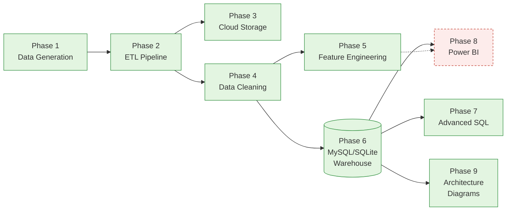
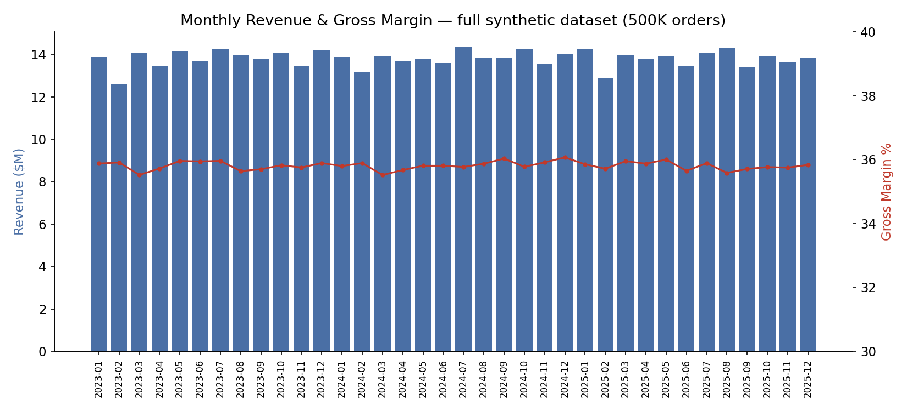
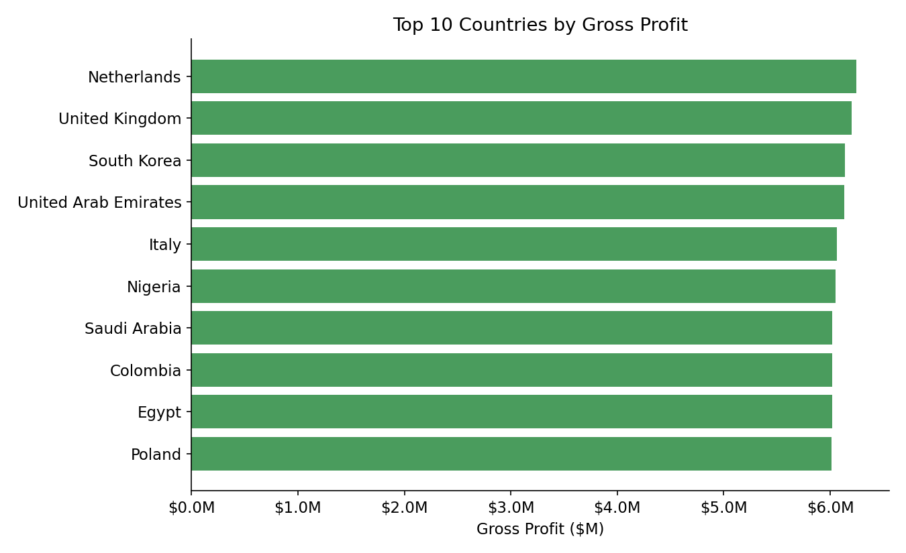
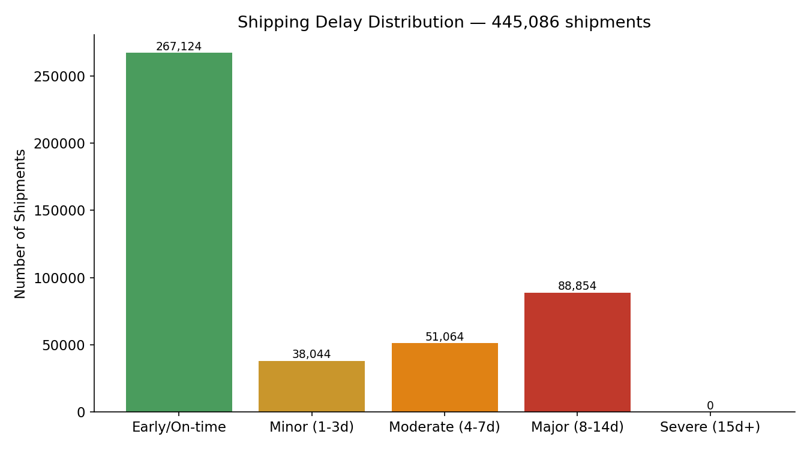
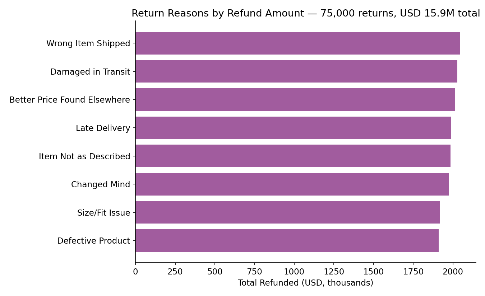
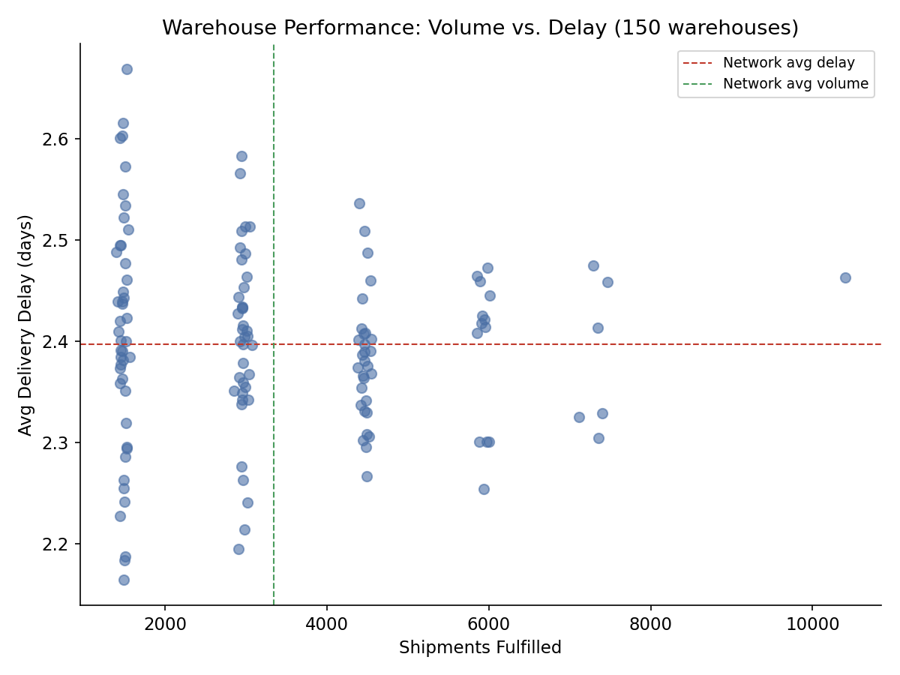

# Enterprise E-Commerce Global Supply Chain & Margin Optimization

An end-to-end data engineering and BI portfolio project: a synthetic but
realistic global e-commerce dataset, a multi-source ETL pipeline, a cloud
storage layer, a cleaned and feature-engineered dataset, a MySQL-style star
schema warehouse, 120+ SQL analyses, a Power BI dashboard design, architecture
diagrams, and a tested codebase — all answering one business question: **why
are margins shrinking, and how much of that is international shipping delays
and cross-border returns?**

**Status: Phase 13 of 15.** Phases 1–12 (data → ETL → cloud → cleaning →
features → warehouse → SQL → dashboard → diagrams → tests → docs → GitHub
packaging) are built, and this phase adds LinkedIn launch assets. See
[CHANGELOG.md](CHANGELOG.md) for the full phase-by-phase build log, including
every bug found and fixed along the way. Phases 14–15 (resume content,
interview prep) are not yet built.

> **Read this first**: the dataset is synthetic (Phase 1 generates it from
> scratch with NumPy/pandas, no real data anywhere in this repo), and several
> pieces of real infrastructure — a MySQL server, cloud storage accounts,
> Power BI Desktop — were not available while building this, so those parts
> are written and checked for correctness but not run against the real thing.
> Every such gap is called out explicitly, not hidden. See
> [Known Limitations](#known-limitations) before you take any number in this
> README as a finding rather than a demonstration.

---

## Problem Statement

A global e-commerce brand ships from 150 warehouses across 30 countries.
Leadership suspects margins are shrinking, but three teams tell three
stories: supply chain blames shipping delays, finance blames discounting,
and customer service blames returns. Nobody has one dataset that joins
orders, shipments, and returns at the order-line level to settle it.

This project builds that dataset and the pipeline that keeps it current:
ingest from three source systems, clean and validate it, engineer the
metrics finance/ops/CS each care about, warehouse it in a queryable star
schema, and answer the question with SQL and a dashboard — not opinions.

## Results & KPIs

Computed by actually running the full pipeline on the full-scale generated
dataset (500,000 orders). These are **demonstration numbers from synthetic
data**, not a real company's results — see the caveat at the top of this
file and [Known Limitations](#known-limitations) for exactly where the
synthetic data shows through (e.g. country-level revenue is nearly uniform,
because Phase 1 doesn't inject a real per-country demand signal).

| KPI | Value |
|---|---:|
| Total orders | 500,000 |
| Total revenue | $497.0M |
| Gross profit / margin | $178.0M / **35.8%** |
| Net profit / margin (after shipping, refunds, 8% assumed opex) | $115.4M / **23.2%** |
| Average order value | $994 |
| Order return rate | 13.7% |
| Repeat purchase rate | 99.96%¹ |
| Average delivery delay | 2.39 days |
| Shipments delayed (>3 days) | 31.4% |

¹ This is a property of the synthetic data's order-to-customer ratio (500K
orders over 50K customers, ~10 orders/customer on average), not a realistic
e-commerce repeat-purchase rate — flagged honestly in Phase 5 and again here
rather than presented as a finding.

### Net margin methodology

Net margin isn't a single formula everyone agrees on, so here's exactly what
this project uses, consistently from Phase 5 through the Power BI DAX in
Phase 8:

```
Product Revenue   = Order Subtotal × (1 − Order Discount %)
Gross Profit      = Product Revenue − COGS
Net Profit        = Gross Profit − Shipping Cost − Refunds − (Product Revenue × 8% assumed opex)
```

The 8% is a named, documented assumption
(`src/feature_engineering/config.py: ASSUMED_OPEX_RATE`) standing in for
warehousing/payment-processing/overhead costs the dataset doesn't model —
change it in one place and every phase that reports net margin picks it up.

## Architecture



Five detailed architecture diagrams live in `architecture/` (source + SVG +
PNG, actually rendered — see `architecture/README.md`):

| | |
|---|---|
| [ETL Flow](architecture/etl_flow.png) | 3-source pipeline: extract (incremental, retry-wrapped) → validate → quarantine/transform → load → watermark state |
| [Cloud Architecture](architecture/cloud_architecture.png) | One interface, three providers (dry-run/GCS/S3), same bucket layout |
| [Warehouse Star Schema](architecture/warehouse_star_schema.png) | Full ER diagram: 5 dimensions + 3 facts, every column and FK |
| [Dashboard Flow](architecture/dashboard_flow.png) | Warehouse → Power BI data model → DAX → 6 pages → interactivity |
| [Git Workflow](architecture/git_workflow.png) | Feature-branch-per-phase workflow, tagged at each merge |

## Tech Stack

| Layer | Tools | Status |
|---|---|---|
| Data generation | Python 3, pandas, NumPy | ✅ Tested, full scale |
| ETL | Flask (mock API), Requests, custom retry/logging | ✅ Tested end-to-end |
| Cloud storage | google-cloud-storage, boto3 (lazy-imported) | ⚠️ Written, not run against a real account |
| Cleaning / features | pandas, NumPy | ✅ Tested, full scale |
| Warehouse | SQLite (stdlib) / MySQL via SQLAlchemy + PyMySQL | ✅ SQLite tested · ⚠️ MySQL untested |
| SQL analysis | Standard SQL, window functions, recursive CTEs | ✅ 120 queries run against the real warehouse |
| BI | Power BI DAX | ⚠️ Written and checked arithmetically, not opened in Power BI Desktop |
| Diagrams | Mermaid / mermaid-cli | ✅ Rendered and inspected |
| Testing | unittest (pytest-compatible), stdlib `trace` for coverage | ✅ 71 tests, 98.7% coverage |

## Screenshots

No Power BI dashboard screenshots exist (see Tech Stack above) — these are
real matplotlib charts generated by querying the actual warehouse database.
See `screenshots/README.md` for what each one shows and for honest notes on
where the synthetic data's limitations show through in the chart itself.







## Business Impact

What this architecture is built to let a real team do — illustrated with the
synthetic data's own numbers as a worked example, not as a real-world claim:

- **Find the worst shipping lanes in seconds, not a cross-team meeting.**
  `sql/business_queries.sql` E3 joins warehouse × destination-country volume
  and delay in one query; on this dataset it flags Santiago Cross-Dock at
  2.67 days average delay against a 2.39-day network average.
- **See exactly how much of gross profit returns are eating**, per product
  and per reason, instead of a single blended "return rate" number —
  `vw_return_hotspots` and query D4 in `business_queries.sql`.
- **Reconcile three teams' numbers against one source of truth.** The same
  net-margin formula (documented above) feeds the Python feature tables, the
  SQL warehouse, and the Power BI DAX — so "what's our margin" has one
  answer, not three.
- **Catch data-quality problems before they reach a dashboard.** The ETL
  pipeline quarantines bad rows instead of silently loading them (Phase 2),
  and Phase 4's cleaner flags statistical outliers rather than deleting them,
  so a genuinely unusual (not broken) high-value order doesn't vanish from
  the analysis.

## Folder Guide

```
Enterprise-Ecommerce-SupplyChain-Optimization/
├── data/
│   ├── raw/                 Phase 1 output - 15 source CSVs (generated, not shipped)
│   ├── processed/           Phase 2 ETL output, Phase 4 cleaned tables, Phase 5 feature tables
│   └── warehouse/           Phase 6 SQLite file + CSV export for Power BI (generated, not shipped)
├── src/
│   ├── data_generation/     Phase 1 - synthetic data generators (10 tables)
│   ├── etl/                 Phase 2 - extract/validate/transform/load + mock Shipping API
│   ├── cloud/                Phase 3 - GCS/S3/dry-run upload
│   ├── cleaning/             Phase 4 - dedup, nulls, negatives, outliers, tz, FX conversion
│   ├── feature_engineering/  Phase 5 - margin, CLV, AOV, return rate, warehouse utilization
│   ├── warehouse/            Phase 6/7/8 - star-schema builders, SQLite/MySQL loaders, SQL runner
│   └── utils/                 shared logging + retry-with-backoff
├── sql/                      Phase 7 - window functions, 107 business queries, views, procedures
├── dashboards/                Phase 8 - Power BI DAX measures + build guide
├── architecture/              Phase 9 - 5 diagrams (Mermaid source + SVG + PNG)
├── screenshots/                Phase 11 - real charts from the warehouse (see above)
├── linkedin/                    Phase 13 - launch assets + post (see Documentation Index)
├── reports/                    data-cleaning report, KPI summary, test coverage report
├── docs/                       SQL query optimization notes
├── tests/                      Phase 10 - 71 unit tests
├── requirements.txt
├── pytest.ini
├── .env.example
├── README.md                   this file
└── CHANGELOG.md                full phase-by-phase build log
```

## Installation

```bash
git clone <this-repo> && cd Enterprise-Ecommerce-SupplyChain-Optimization
pip install -r requirements.txt   # pandas/numpy/flask/requests/pytest are all you need
                                   # for the tested path (sqlite + dry_run cloud)

# 1. Generate the full synthetic dataset (~15s, 500K orders)
python -m src.data_generation.run_all

# 2. Clean it
python -m src.cleaning.run_cleaning

# 3. Load the star-schema warehouse (SQLite, zero extra setup)
python -m src.warehouse.run_load_warehouse

# 4. Run the SQL analyses against it
python -m src.warehouse.run_sql_file sql/business_queries.sql --show 2

# 5. Run the tests
python -m unittest discover -s tests -v
```

Optional, each needs real infrastructure not available while building this
(see Known Limitations): `src.etl.run_pipeline` + `src.etl.shipping_api_server`
(Phase 2 ETL demo), `src.cloud.run_upload --provider gcs|s3` (real cloud),
`src.warehouse.run_load_warehouse --engine mysql` (real MySQL), opening
`dashboards/dax_measures.dax` in Power BI Desktop.

## Known Limitations

Every phase's detailed verification notes are in
[CHANGELOG.md](CHANGELOG.md). The infrastructure gaps, in one place:

| What | Why | What was done instead |
|---|---|---|
| Real GCS / S3 | No cloud account/credentials available | `dry_run` provider (local-folder stand-in) tested end-to-end; real providers written against documented SDK APIs |
| Real MySQL server | None available, no network to install one | SQLite tested end-to-end (1.5M+ rows, zero orphaned FKs); `sql/schema.sql` and `mysql_loader.py` written against MySQL 8.0 syntax, untested |
| Power BI Desktop | Windows-only GUI software, this is a Linux/no-GUI environment | Every DAX measure's expected value checked arithmetically against the real warehouse in SQL first |
| `sql/procedures.sql` | SQLite has no stored procedures/functions at all | Written against MySQL 8.0 syntax, genuinely never executed |
| `pytest` / `coverage.py` | No network access to `pip install` | `unittest.TestCase` (pytest-compatible, stdlib-only) + stdlib `trace` module instead; same tests will run under real pytest unmodified |

## Testing & Quality

**71 tests, 98.7% line coverage, 0 failures** — see
`reports/test_coverage_report.md` for the full breakdown and the one real bug
these tests found (a `ZeroDivisionError` in margin calculation, caused by a
pandas dtype-contamination edge case, fixed in 3 places).

## Future Improvements

- Run `src.warehouse.run_load_warehouse --engine mysql` and
  `src.cloud.run_upload --provider gcs` against real infrastructure and fix
  whatever the first real run surfaces.
- Give Phase 1 a real per-country demand signal (population/GDP-weighted
  order volume) instead of uniform random assignment, so country-level
  analysis has a genuine signal instead of near-uniform noise (see Chart 2's
  caveat above).
- Model warehouse assignment by proximity to the customer instead of
  uniformly at random — Phase 8 found this makes 96.7% of orders
  "cross-border," which is a data-generation artifact, not realistic.
- Add inventory and payments as proper fact tables in the warehouse (Phase 6
  deliberately scoped to FactSales/FactShipping/FactReturns only).
- Build a real `.pbix` once Power BI Desktop is available, and screenshot it
  for real.
- Add integration tests that run the full pipeline end-to-end (current tests
  are unit-level, each phase tested in isolation with small fixtures).

## Documentation Index

- [CHANGELOG.md](CHANGELOG.md) — full phase-by-phase build log
- [RELEASE_NOTES.md](RELEASE_NOTES.md) — one entry per version tag
- [GITHUB_SETUP.md](GITHUB_SETUP.md) — repo description/topics, and an honest
  note on what the commit history is (and isn't)
- [LICENSE](LICENSE) — MIT
- `architecture/README.md` — diagram details + regeneration instructions
- `dashboards/README.md` — Power BI build guide
- `docs/sql_query_optimization.md` — index behavior, measured query speedups
- `reports/test_coverage_report.md` — test suite details
- `reports/data_cleaning_report.md`, `reports/kpi_summary.json` — sample
  output from a full-scale run
- `linkedin/README.md`, `linkedin/LINKEDIN_POST.md` — launch assets and post,
  including why the "dashboard preview" isn't a Power BI screenshot

## Roadmap

- [x] Phase 1 — Enterprise Data Generation
- [x] Phase 2 — Multi-Source ETL Pipeline
- [x] Phase 3 — Cloud Storage
- [x] Phase 4 — Data Cleaning
- [x] Phase 5 — Feature Engineering
- [x] Phase 6 — MySQL Data Warehouse
- [x] Phase 7 — Advanced SQL
- [x] Phase 8 — Power BI Executive Dashboard
- [x] Phase 9 — Architecture Diagrams
- [x] Phase 10 — Testing
- [x] Phase 11 — Documentation
- [x] Phase 12 — GitHub packaging (.gitignore, LICENSE, release notes)
- [x] Phase 13 — LinkedIn launch assets
- [ ] Phase 14 — Resume content
- [ ] Phase 15 — Interview preparation
