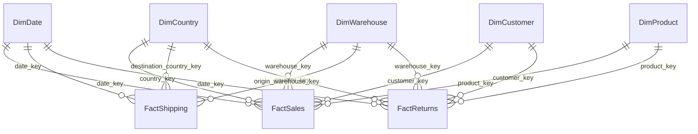

# Power BI Executive Dashboard & Interactive Viewer

This directory contains the **Interactive Power BI Dashboard** (`interactive_powerbi.html`), the complete **DAX Measures Library** (`dax_measures.dax`), and the step-by-step build guide for connecting to the star-schema warehouse.

---

## 🚀 Instant Interactive Viewer

Open [`interactive_powerbi.html`](interactive_powerbi.html) directly in any web browser to explore the full dashboard:
- **6 Report Pages**: Executive Overview, Global Geography & Profit, Warehouse Delays, Shipping Intelligence, Customer Analytics, and Net Margin Waterfall.
- **Dynamic Slicers**: Live filtering by Year (2023–2025), Region (5 global regions), and Category with instant metric recalculation.
- **Interactive Drill-Through**: Click on any country in the matrix for country-specific deep-dive diagnostics.
- **Verified DAX Inspector**: Inspect the exact DAX measures reconciled against the warehouse.
- **CSV Data Export**: One-click download of filtered analytical summaries.

---

## 1. Connect to the Data

Three options, in order of how much setup they need:

### Option A — CSV folder (fastest, no server or driver needed)
```bash
python -m src.warehouse.run_load_warehouse       # builds data/warehouse/warehouse.db
python -m src.warehouse.export_to_csv            # dumps every table to data/warehouse/csv_export/
```
In Power BI Desktop: **Get Data → Folder** → point at `data/warehouse/csv_export/`
→ **Combine & Transform** won't apply here (these are 8 different tables, not
one); instead use **Get Data → Text/CSV** once per file so each lands as its
own table with the right name. This was tested end-to-end here (all 8 CSVs
exported correctly, `FactSales.csv` is 176 MB / 1.5M rows).

### Option B — Real MySQL (the production path)
```bash
export MYSQL_HOST=... MYSQL_USER=... MYSQL_PASSWORD=... MYSQL_DATABASE=ecommerce_supply_chain
python -m src.warehouse.run_load_warehouse --engine mysql
```
In Power BI Desktop: **Get Data → MySQL database**, point at the same host/db.
Not tested here (no MySQL server available — same caveat as Phases 3 and 6).

### Option C — the local SQLite file directly
Power BI Desktop has no built-in SQLite connector. If you install a SQLite
ODBC driver, you can use **Get Data → ODBC** against `data/warehouse/warehouse.db`.
Untested here; Option A is simpler if you don't already have that driver.

## 2. Data model

Import all 8 tables, then set up relationships to match the star schema built
in Phase 6 (Power BI should auto-detect most of these from column names —
verify each one):



Required model settings:
- **Mark `DimDate` as a date table**: Model view → right-click `DimDate` →
  *Mark as date table* → key column `full_date`. Every time-intelligence
  measure (`Revenue YoY %`, `Revenue MoM %`) depends on this.
- **Set `DimCountry[country_name]` Data Category to "Country"** (Column tools
  ribbon) so the Page 2 map visual can geocode it.
- All relationships should be **one-to-many, single direction**, dimension →
  fact. `FactShipping`'s two country/warehouse-shaped columns
  (`destination_country_key`, `origin_warehouse_key`) both point at the *same*
  `DimCountry`/`DimWarehouse` tables — Power BI will only auto-activate one
  relationship per table pair, so the other needs `USERELATIONSHIP()` in any
  measure that needs it (already handled in `dax_measures.dax` where relevant).

## 3. DAX measures

All measures are in **`dashboards/dax_measures.dax`** — paste them into a new
table (e.g. right-click in Fields pane → *New table* → name it `_Measures`,
then paste each measure individually via *New measure*, or paste the whole
file into Tabular Editor / DAX Studio if you have either).

Every headline measure has an **expected value comment**, computed directly
against the real warehouse (e.g. `Total Revenue` → $497,018,076.76). Build the
measure, check it against a Card visual, and if it doesn't match, something in
the model (usually a missed relationship) needs fixing before you build
further on top of it.

**Net Margin uses the same 8% assumed-OpEx rate as Phase 5** (see
`ASSUMED_OPEX_RATE` in `src/feature_engineering/config.py`) — this keeps the
number consistent whether someone reads it from a Python report or the
dashboard. If you change the assumption in one place, change it in both.

## 4. Pages

### Page 1 — Executive Overview
KPI cards: `Total Revenue`, `Total Gross Profit`, `Gross Margin %`,
`Total Net Profit`, `Net Margin %`, `Total Orders`, `Return Rate (Orders)`.
Line chart: revenue by month (`DimDate[full_date]` on axis, `Total Revenue`
on values), with `Revenue MoM %` and `Revenue YoY %` as secondary cards or a
tooltip. A slicer on `DimDate[year]` and `DimCountry[region_name]` at the top,
synced to every page (Slicer → Sync Slicers pane).

### Page 2 — Global Map
Filled Map or ArcGIS Map visual: Location = `DimCountry[country_name]`, Color
saturation = `Net Margin %` or `Total Revenue`. Matrix or table alongside:
country, `Total Revenue`, `Gross Margin %`, `Return Rate by Country`,
`Revenue Rank by Country`. Drill-through target: clicking a country goes to a
**Country Detail** drill-through page (Page 2a) showing that country's
products, top customers, and shipping performance — set the drill-through
filter field to `DimCountry[country_name]` in the target page's Drill-through
well.

### Page 3 — Warehouse Performance (Delay Analysis)
Bar chart: `Avg Delivery Delay (Days)` by `DimWarehouse[warehouse_name]`,
sorted descending, top 15. Card: `Severe Delay Shipments (15d+)`. Table:
warehouse, `Shipments`, `Avg Delivery Delay (Days)`, `On-Time Rate`,
`Worst Warehouse Rank (by Delay)`. **Utilization %**: import
`data/processed/features/dim_warehouse_features.csv` (Get Data → Text/CSV) and
relate it to `DimWarehouse` on `warehouse_id` — this metric needs inventory
data that isn't in the star schema by design (see Phase 6 README).

### Page 4 — Shipping Intelligence (Logistics Partner Comparison)
Table: `FactShipping[partner_id]`, `Shipments`, `Partner Avg Delay`,
`Partner On-Time Rate`, `Partner Rank (Best to Worst)`. Scatter chart: X =
`Shipments`, Y = `Partner Avg Delay`, to spot high-volume/high-delay partners
at a glance (same idea as `Delay Volume Score`, shown visually instead of as
one number).

### Page 5 — Customer Analytics (CLV, Retention, Repeat Purchases)
Cards: `Total Customers`, `Repeat Purchase Rate`,
`Avg Customer Lifetime Value (Historical)`. Bar chart: customers by
`Customer Value Quartile`. For **retention curves**, either (a) reuse the
recursive-CTE cohort query from `sql/business_queries.sql` (C11) as a
DirectQuery/native-SQL source, or (b) build a DAX calculated table for the
cohort-month × month-offset spine — (a) is far simpler since that SQL is
already written and tested. **Projected CLV**: import
`data/processed/features/dim_customer_features.csv` and relate to
`DimCustomer` on `customer_id`, per the note in `dax_measures.dax`.

### Page 6 — Profit Analysis (Margins, Returns, Shipping Cost)
Waterfall chart: `Total Revenue` → minus COGS → minus `Total Shipping Cost` →
minus `Total Refunds` → minus `Assumed OpEx` → `Total Net Profit`. Table:
return reason, count, refund $ (from `FactReturns[return_reason]`). Card:
`Top Return Reason`.

## 5. Advanced DAX / interactivity features (spec requirements)

- **Drill-through pages**: build a hidden "Country Detail" page, add
  `DimCountry[country_name]` to its Drill-through filter well, right-click any
  country value on Page 2 → Drill through. Same pattern for a "Product Detail"
  or "Warehouse Detail" page.
- **Bookmarks**: capture 2-3 states on Page 1 (e.g. "This Year" vs "Last Year"
  filter state, or a KPI-cards-only view vs a full-detail view) via the
  Bookmarks pane, and add buttons to switch between them.
- **Tooltips**: use `Selected Country Revenue Tooltip` /
  `Selected Warehouse Delay Tooltip` (both in `dax_measures.dax`) as a report-
  page tooltip (Format visual → Tooltip → Report page → a small hidden page
  with just that text card), shown on hover over the map or warehouse chart.
- **Dynamic filters**: slicers on `DimDate[year]`, `DimCountry[region_name]`,
  `DimProduct[category]`, synced across pages (View → Sync Slicers).

## 6. Verified, not just written

- **DAX arithmetic checked against the real warehouse in Python/SQL** — every
  headline measure's expected value comment in `dax_measures.dax` comes from
  an actual query against the 1.5M-row `FactSales` table, not a guess.
- **A real gap in the Phase 6 schema, found and fixed while designing this
  phase**: `FactReturns` had no country or warehouse key, so a "return rate by
  country" measure would have silently returned the same (global) number for
  every country instead of filtering correctly. Added `warehouse_key` /
  `country_key` / `is_cross_border` to `FactReturns`, and `line_shipping_cost_usd`
  / `is_cross_border` to `FactSales` (needed for the Page 6 waterfall and the
  project's cross-border cost theme). Re-ran the full pipeline afterward:
  zero orphaned rows, and the newly-added `line_shipping_cost_usd` reconciles
  with Phase 5's independently-computed shipping cost to within $1.37 on $7M.
  All 120 Phase 7 SQL queries were re-run against the patched schema and still
  pass.
- **A synthetic-data quirk surfaced by the new `is_cross_border` flag**: 96.7%
  of orders come out "cross-border." That number is exactly `1 − 1/30` (30
  countries), which means it's a direct consequence of Phase 1 assigning each
  order's fulfillment warehouse uniformly at random, independent of the
  customer's country — not a real "most orders cross a border" finding. The
  flag is computed correctly; the underlying data just has no "ship from
  nearest warehouse" logic. Worth knowing before this number appears on a
  slide.

## Folder Contents

```
dashboards/
├── interactive_powerbi.html   (interactive web dashboard with 6 pages, slicers, drill-through)
├── index.html                 (web entrypoint for local or GitHub Pages preview)
├── dax_measures.dax           (every DAX measure, organized by page)
└── README.md                  (this file)
src/warehouse/
└── export_to_csv.py           (dumps the warehouse to CSV for Power BI Desktop import)
```
